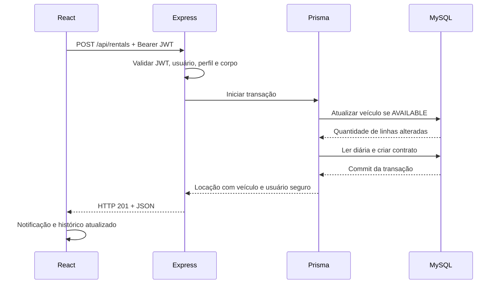

# Apresentação do DriveFlow

## Preparação

Antes da aula, instale as dependências, configure `backend/.env`, inicie MySQL e execute na raiz:

```bash
npm run db:generate
npm run db:migrate
npm run db:seed
npm run dev
```

Ative `SEED_DEMO=true` para inserir veículos de apresentação. Escolha suas próprias credenciais administrativas no ambiente. Abra `http://localhost:5173`. Não mostre `.env`, senhas ou tokens no projetor. Reserve uma conta de cliente para demonstrar as operações reais.

Se não houver MySQL disponível, explique que a integração depende do serviço e prepare-o antes da apresentação. O frontend não simula dados quando a API está indisponível.

## Ordem sugerida (12 a 15 minutos)

| Tempo | Demonstração | O que explicar |
| --- | --- | --- |
| 1 min | Objetivo e arquitetura | Problema da locadora e divisão frontend/backend |
| 2 min | Login administrativo e dashboard | JWT, perfil e indicadores da API |
| 2 min | Cadastro/edição de veículo | Validação, placa única e diária decimal |
| 2 min | Cadastro de cliente e catálogo | Cadastro público sem privilégios, filtros |
| 2 min | Registrar locação | Transação, diária contratada e indisponibilidade |
| 2 min | Histórico e devolução | Propriedade, cálculo final e liberação |
| 2 min | API, código e testes | REST, relacionamentos e concorrência |
| 1 min | Diagramas e encerramento | Responsabilidades dos integrantes |

### 1. Login

Entre com o administrador criado pelo seed. Mostre o nome, o perfil e as opções de gestão na sidebar. Explique que esconder botões não é suficiente: a API também verifica o perfil. Mostre `middlewares/auth.ts` e a chamada de `/auth/me` no frontend.

### 2. Cadastro de veículo

Abra **Gerenciar frota → Cadastrar veículo**. Preencha marca, modelo, ano, placa válida e única, cor, categoria e diária com ponto decimal, por exemplo `179.90`. Imagem é opcional. Salve e abra os detalhes. Tente cadastrar a mesma placa para mostrar o conflito; depois retorne ao fluxo principal.

### 3. Catálogo do cliente

Saia e use **Cadastre-se**. A confirmação de senha é validada no frontend, e a API cria somente CLIENTE. Pesquise pela marca cadastrada e filtre por Disponíveis. Mostre os detalhes e o preço por diária.

### 4. Locação

Clique **Alugar este veículo**. O início é a retirada imediata e é atualizado ao confirmar. Escolha uma devolução futura. Confira quantidade de diárias e total previsto. Confirme uma única vez e abra **Minhas locações**.

Explique que usuário e preço vêm do servidor. O contrato registra o preço naquele momento. O frontend mostra uma estimativa; a API calcula novamente usando `Prisma.Decimal`.

### 5. Disponibilidade

Volte ao catálogo e mostre o veículo como Alugado. Com o filtro Disponíveis, ele não aparece. Explique a atualização condicional na transação. Não afirme que clicar em duas abas comprova sozinho toda a concorrência: a suíte de integração envia requisições simultâneas e verifica o banco real.

### 6. Devolução

Abra **Minhas locações → Devolver**, confira a confirmação e conclua. Mostre status Concluída, data de retorno e valor final. Uma devolução imediata custa uma diária; a diária adicional começa após completar mais 24 horas. Volte ao catálogo e mostre o veículo disponível novamente.

### 7. Visão administrativa e integridade

Entre novamente como administrador e abra **Todas as locações**. Mostre o cliente vinculado. Tente excluir o veículo utilizado: o sistema bloqueia porque possui histórico. Explique que esse bloqueio preserva os contratos.

## Como demonstrar a API

Use Postman, Insomnia ou os exemplos de `API.md`:

1. `POST /api/auth/login`: obtenha um token sem projetar seu valor completo.
2. Configure a autorização Bearer da coleção.
3. `GET /api/vehicles?status=AVAILABLE`: mostre JSON, paginação e filtros.
4. Remova a autorização e repita: mostre HTTP 401.
5. Com token de CLIENTE, tente `POST /api/vehicles`: mostre HTTP 403.
6. Consulte `/api/rentals`: explique que o filtro de proprietário é aplicado no servidor.
7. Se houver tempo, use `/api/rentals/:id/return` e explique o 409 em uma repetição.

## Comunicação entre as camadas



Se alguma etapa da transação falha, o MySQL reverte as alterações. Na tentativa concorrente, somente uma transação consegue reivindicar o veículo disponível.

## JWT em linguagem simples

O login compara a senha digitada ao hash bcrypt. Se corresponder, o servidor assina um token com o identificador do usuário, expiração, emissor e audiência. O navegador guarda o token em `sessionStorage` e o envia nas chamadas privadas. O middleware valida a assinatura e busca o perfil atual no banco. JWT é assinado, não criptografado; não deve carregar senhas. A resposta 401 encerra a sessão no frontend. Logout remove o token da aba; ele não cria uma lista de revogação no servidor.

## Prisma e relacionamentos

`User` tem várias `Rental`; `Vehicle` também tem várias `Rental` ao longo do tempo. Cada locação contém duas FKs: `userId` e `vehicleId`. O schema descreve tabelas, campos, enums, precisão decimal, índices e restrições. A migration registra como construir essa estrutura no MySQL. Prisma Client oferece métodos tipados como `findMany`, `create` e `$transaction`.

## Dez perguntas técnicas prováveis

Estas são perguntas de estudo preparadas pelo projeto, não as questões oficiais da entrega individual.

1. **Por que frontend e backend são separados?** React apresenta e coleta dados; Express valida, autoriza e executa as regras. A API pode atender outros clientes sem repetir regras de negócio.
2. **Por que TypeScript não substitui Zod?** TypeScript verifica o código durante o desenvolvimento. Dados HTTP chegam em tempo de execução e podem ser enviados por qualquer cliente; Zod valida esses dados reais.
3. **Como a senha é protegida?** bcrypt cria um hash com salt e custo 12. O login usa `compare`, e o sistema nunca devolve esse hash em JSON.
4. **Autenticação e autorização são iguais?** Autenticação identifica quem fez a chamada. Autorização determina se a pessoa pode cadastrar um veículo ou acessar aquele contrato. A propriedade de locações também é verificada.
5. **Como duas pessoas não alugam o mesmo veículo?** A transação tenta alterar AVAILABLE para RENTED usando uma condição na própria escrita. O MySQL bloqueia a linha, uma operação vence e a outra recebe conflito. O contrato é criado na mesma transação.
6. **Por que não usar apenas `if (vehicle.status === AVAILABLE)`?** Entre uma leitura e uma escrita separadas, outra chamada pode mudar o registro. A atualização condicional é avaliada durante a escrita e participa da transação.
7. **Por que usar Decimal e copiar a diária?** Números binários podem introduzir erros monetários. Decimal preserva precisão e copiar a diária impede que mudanças no catálogo alterem o contrato já fechado.
8. **Como a devolução calcula o valor?** Usa o horário do servidor, calcula blocos de 24 horas arredondados para cima, com mínimo de um, e multiplica pela diária contratada. Não confia em data ou total enviados pelo navegador.
9. **Por que um veículo com histórico não pode ser excluído?** O histórico referencia aquele veículo. Apagá-lo quebraria a rastreabilidade; a API retorna uma mensagem e as FKs RESTRICT reforçam a integridade no banco.
10. **Qual a diferença entre teste unitário e de integração aqui?** O unitário testa fórmulas e validações sem banco. O de integração chama rotas HTTP com Supertest e verifica persistência e concorrência no MySQL. Um não substitui o outro.

## Divisão sugerida de estudo

Cada integrante deve compreender o fluxo completo. Para aprofundamento, podem dividir autenticação/permissões, veículos/interface, locações/transações e testes/documentação. Preencham os nomes no README conforme o trabalho real do grupo.
