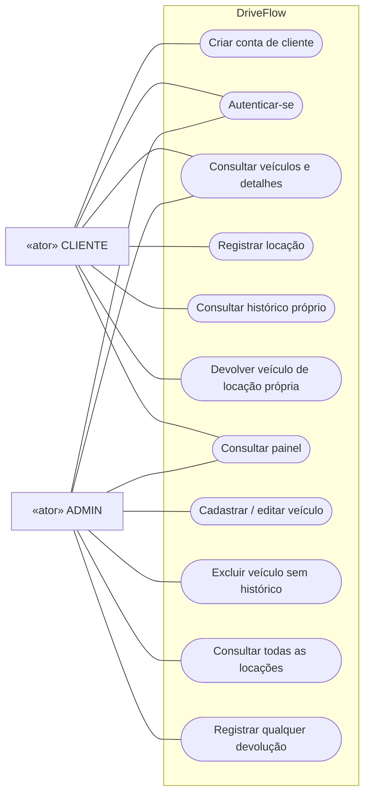

# Proposta inicial — diagrama de casos de uso

Adapte esta proposta caso o professor tenha solicitado outra notação ou outros diagramas. Para desenhar à mão, use folha A4 em paisagem, uma caixa central chamada **DriveFlow**, CLIENTE à esquerda e ADMIN à direita. Desenhe os casos como elipses e os atores como figuras humanas. Linhas simples indicam associação, sem direção obrigatória.

O Mermaid é uma representação legível para consulta; no papel, substitua os retângulos dos atores pelos símbolos UML. Não é necessário usar uma relação de herança entre ADMIN e CLIENTE, pois o administrador não registra locações no sistema.

## Notas para a folha

- Criar conta é público e gera CLIENTE. O ADMIN inicial é criado pelo seed, fora do fluxo público.
- As demais operações exigem autenticação, exceto o próprio login.
- A locação exige veículo disponível e período válido.
- A devolução encerra a locação e libera o veículo.
- Exclusão exige ausência de histórico.
- Painel do cliente apresenta locações próprias; painel do administrador apresenta a operação geral.

Para caber em A4, posicione autenticação, consulta de veículos e painel na coluna central. Coloque operações exclusivas de cliente à esquerda dentro do sistema e operações administrativas à direita. Evite cruzar linhas e use rótulos curtos. Essas regras são notas do diagrama, não perguntas da entrega individual.
