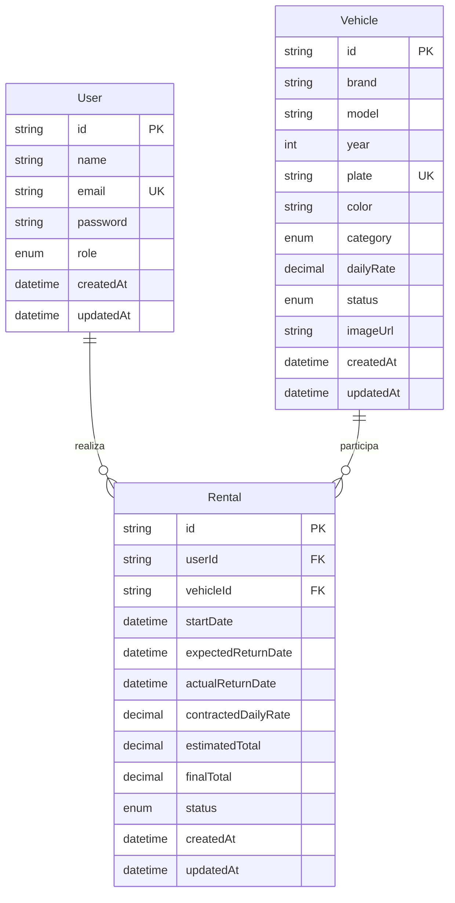

# Proposta inicial — diagrama de entidades

Use A4 em paisagem. Desenhe **User** à esquerda, **Rental** no centro e **Vehicle** à direita. Marque PK (chave primária), FK (chave estrangeira) e UK (valor único). User e Vehicle podem existir sem locações; cada Rental exige exatamente um usuário e um veículo.



## Legenda de tipos e restrições

- IDs: UUID armazenado como CHAR(36).
- `User.role`: ADMIN ou CLIENTE.
- `User.password`: hash bcrypt, nunca a senha em texto.
- `Vehicle.category`: ECONOMY, SEDAN, SUV, HATCH, PICKUP, LUXURY.
- `Vehicle.status`: AVAILABLE, RENTED, MAINTENANCE.
- `Rental.status`: ACTIVE, COMPLETED.
- Diárias: DECIMAL(10,2). Totais: DECIMAL(12,2).
- `imageUrl`, `actualReturnDate` e `finalTotal`: opcionais.
- Exclusão de usuário/veículo com contratos: restringida por FK.
- Índices: veículo por status/categoria; locações por usuário/data, veículo/status e status/data.

## Cardinalidade para copiar à mão

```text
User (1) ───────── (0..N) Rental (0..N) ───────── (1) Vehicle
```

A relação permite vários contratos históricos por veículo. A regra de no máximo uma locação ativa por veículo é assegurada no serviço transacional com bloqueio da linha do veículo; a cardinalidade histórica sozinha não representa essa regra.

Esta é uma proposta de diagrama de entidades. Se o professor exigir um diagrama de classes UML, adapte os retângulos e associações à notação pedida. O schema Prisma é a referência para os campos implementados.
